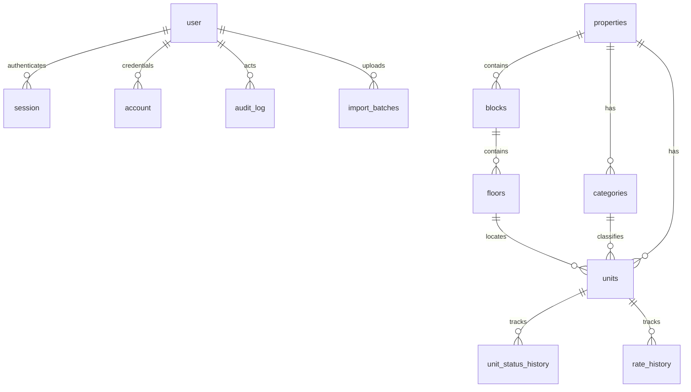

# Data model

Hierarchy: **Property > Block > Floor > Unit**. One property in production: Sardar's Mall (368 units, 11 floors).

## Entities

| Entity                                          | Key  | Notes                                             |
| ----------------------------------------------- | ---- | ------------------------------------------------- |
| `properties`                                    | uuid | Name unique in practice; seed is "Sardar's Mall"  |
| `blocks`                                        | uuid | Belongs to a property                             |
| `floors`                                        | uuid | Belongs to a block; `level` is a display string   |
| `categories`                                    | uuid | `is_sellable_default` copied onto new units       |
| `units`                                         | uuid | `unit_code` unique per property                   |
| `unit_status_history`                           | uuid | One row per status change                         |
| `rate_history`                                  | uuid | One row per rate change                           |
| `unit_pricing`                                  | view | `round(rate * net_area + adjustment, 2)`          |
| `user` / `session` / `account` / `verification` | text | Better Auth                                       |
| `audit_log`                                     | uuid | `before` / `after` jsonb                          |
| `import_batches`                                | uuid | Original path, raw rows, counts, warnings, errors |

## Unit fields

`unit_code`, `unit_number`, `floor_id`, `category_id`, `net_area_sqft numeric(10,2)`, `gross_area_sqft` nullable, `rate_per_sqft_pkr numeric(14,2)`, `price_adjustment_pkr`, `price_adjustment_reason`, `sold_price_pkr` (frozen on sale), `status` `AVAILABLE|SOLD` (enum is extensible), `is_sellable`, `ownership_group`, `sub_owner`, `booking_ref`, `notes`, `version`, `archived_at`.

## Invariants

- Money is numeric. Never float.
- Live asking price = rate × net area + adjustment (SQL view + `computeTotalPrice`).
- On sale, copy that amount into `sold_price_pkr` and stop using the live formula for that unit.
- Status changes go through `changeUnitStatus`: `SELECT … FOR UPDATE`, compare `version`, bump it, write history + audit in the same transaction.
- Only `ADMIN` can reverse `SOLD` → `AVAILABLE`, and a reason is required.
- Do not overwrite a `SOLD` unit on re-import without admin.

## ER diagram

