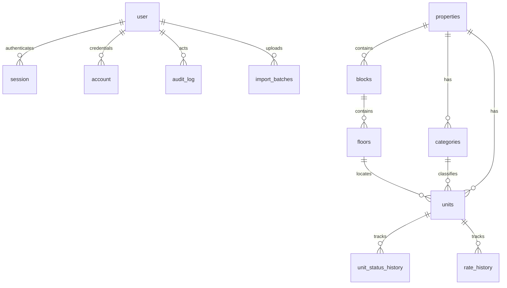

# Data model

Hierarchy: **Property > Block > Floor > Unit**. One property in production: Sardar's Mall (368 units, 11 floors).

## Entities

| Entity                                          | Key  | Notes                                                                                                       |
| ----------------------------------------------- | ---- | ----------------------------------------------------------------------------------------------------------- |
| `properties`                                    | uuid | Name unique among live rows; `archived_at` soft delete; seed is "Sardar's Mall"                             |
| `blocks`                                        | uuid | Belongs to a property; `archived_at` soft delete                                                            |
| `floors`                                        | uuid | Belongs to a block; `level` is the storey number (0 = Ground); `name` is the canonical label                |
| `categories`                                    | uuid | `is_sellable_default` copied onto new units                                                                 |
| `units`                                         | uuid | `unit_code` unique per property                                                                             |
| `unit_status_history`                           | uuid | One row per status change; snapshots `booking_ref` and `sold_price_pkr`; indexed on `(unit_id, created_at)` |
| `rate_history`                                  | uuid | One row per rate change: old rate, new rate, actor, reason, timestamp                                       |
| `unit_pricing`                                  | view | `round(rate * net_area + adjustment, 0)` — whole rupees                                                     |
| `user` / `session` / `account` / `verification` | text | Better Auth                                                                                                 |
| `audit_log`                                     | uuid | `before` / `after` jsonb                                                                                    |
| `import_batches`                                | uuid | Original path, raw rows, counts, warnings, errors                                                           |

## Unit fields

`unit_code`, `unit_number`, `floor_id`, `category_id`, `net_area_sqft numeric(10,2)`, `gross_area_sqft` nullable, `rate_per_sqft_pkr numeric(14,2)`, `price_adjustment_pkr`, `price_adjustment_reason`, `sold_price_pkr` (frozen on sale), `sold_at`, `sold_by`, `status` `AVAILABLE|SOLD` (enum is extensible), `is_sellable`, `ownership_group`, `sub_owner`, `booking_ref`, `notes`, `version`, `archived_at`.

## Invariants

- Money is numeric. Never float.
- Live asking price = round(rate × net area + adjustment) to whole rupees (SQL view + `computeTotalPrice`). Decimal strings only; never JS floats.
- Changing `rate_per_sqft_pkr` writes `rate_history` (old, new, actor, reason, timestamp) in the same transaction as the unit update.
- Unit create/edit/archive uses an optimistic `version` lock. A stale submit is rejected with "This unit was changed by someone else. Reload to see the latest."
- Rate, net/gross area, and price adjustment on a `SOLD` unit are locked for everyone except `ADMIN`.
- On sale, copy that amount into `sold_price_pkr`, set `sold_at` / `sold_by`, store `booking_ref`, and stop using the live formula for that unit.
- Status changes go through `changeUnitStatus` only: `SELECT … FOR UPDATE`, compare `version`, validate the transition map, bump version, write `unit_status_history` + `audit_log` in the same transaction. Allowed today: `AVAILABLE → SOLD`, `SOLD → AVAILABLE`. The map lives in `src/features/units/status.ts` so `RESERVED` / `BOOKED` can be added later.
- Units with `is_sellable = false` or `archived_at` set cannot be sold.
- Only `ADMIN` can reverse `SOLD → AVAILABLE`. Reason min 10 characters. Reverse clears `sold_price_pkr`, `sold_at`, `sold_by` and keeps `booking_ref` on the unit and in history.
- Do not overwrite a `SOLD` unit on re-import without admin.
- Soft-delete structure with `archived_at`. A floor or block (and a property) cannot be archived while it still has active, non-archived units.
- Seeded Main block of Sardar's Mall has 11 floors with normalised labels: Ground, 1st–10th (`level` 0–10).

## ER diagram

